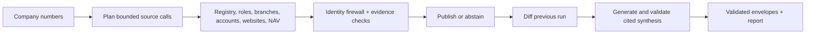

# Signalpost

An agentic AI system for Norwegian company research that gathers official and company-owned evidence, verifies identity, and publishes supported claims or explicit abstentions.

The agent uses deterministic source planning and verification, then builds an evidence-checked company summary. Template mode works without keys and is the default. An optional provider interface supports placeholder-only model output; it is tested with a fake provider and has no live API adapter in this release.

## How it works



The agent reserves an envelope for every unique input before requests, isolates company/section failures, and preserves input order. It prefers the bulk registry snapshot, uses live fallback, and optionally adds website identity proof and exact-company job advertisements. [Agent loop](docs/AGENT.md).

## Install and run

Python 3.12+ and [uv](https://docs.astral.sh/uv/) are required.

```sh
uv sync --frozen
uv run signalpost run --organisations batch.jsonl --bulk registry.csv --output out/envelopes.jsonl --report out/report.json --websites --hiring --synthesis template --envelope-shape union --max-requests 8000 --time-budget-seconds 900 --nav-max-details 300
```

Input accepts JSONL organisation_number rows (extra keys ignored), numeric identifiers, a JSON list or organisation_numbers object, or plain lines, including BOM/CRLF and trailing blanks. Numbers remain strings; whitespace/BOM are normalized and mod-11 validated. The default preserves one envelope per input record in original order, including duplicates and invalid records; duplicates share research. `--deduplicate` explicitly emits unique identifiers only. Invalid identifiers retain failed envelopes without requests. Omit `--bulk` for live identity lookup; omit `--websites` or `--hiring` to disable those tools. Add `--previous prior.jsonl` for refresh.

Useful defaults and controls:

| Scope | Flags / defaults |
|---|---|
| Batch | `--workers 64`, `--host-concurrency 10`, `--max-requests` defaults to 20 × unique input identifiers, `--time-budget-seconds 2400`, `--deadline-fraction 0.85` (34-minute source watchdog), `--request-timeout 10` |
| Output | `--state-dir state`, `--envelope-shape union`, `--max-output-mb 64`, optional `--expected-count` |
| Websites | `--website-request-cap 6`, `--website-total-request-cap 9`; 8-second source bounds, 1-second domain politeness |
| NAV | `--nav-max-pages 512`, `--nav-max-details` defaults to max(300, half the batch rounded up), `--nav-time-cap-seconds` defaults to min(600, 35% of run time), `--nav-lookback-days 185`, `--nav-concurrency 8`, `--nav-request-timeout 30`; independent connection pool |
| Cost | `--max-cost-usd 0`, `--official-batch-size 1100` |
| Synthesis | `--synthesis template` (default), `auto` or `llm`; `--llm-max-calls 100`, `--llm-max-cost-usd 0.50`; one call/company, 15-second timeout |

NAV detail retries count toward the cap. Header names discover candidates; detail employer numbers alone authorize claims. Optional NAV_API_TOKEN is read from the shell environment, otherwise a public credential is retrieved. No .env loader runs. `.env.example` lists the variable without a credential. Set `--website-user-agent` to identify your deployment contact; the default links this repository.

## Evidence and safety

- The identity firewall checks exact company/parent identifiers. Guessed websites require exact organisation-number proof; registered domains have stricter documented corroboration rules. Same-name companies and group navigation do not alone establish ownership.
- Every published fact links a source URL/identifier, UTC retrieval time, stored-body SHA-256, locator, extractor version and a verbatim span of at most 300 characters. Unknown/failure placeholders never invent evidence.
- Availability is explicit: available, not_available, blocked, not_applicable, ambiguous or failed. Missing values are null; numeric zero is retained only when reported.
- Financial claims are reported exact-company values with fiscal period/currency/unit. Whole-NOK metadata has a documented four-ratio calibration; no financial multiplier or derived metric is published.
- URL allowlists, DNS pinning, robots, redirect checks and per-source/global budgets constrain requests. Source bodies stay local; tokens are never stored in blobs or logs.
- Summary sentences cite supported claims. Numbers, dates, names, URLs and verbatim quotes are checked against those citations. Workplace, board and ad counts cite distinct underlying records and remain derived summary metadata, outside the source-fact claims list. Invalid sentences are dropped with recorded reasons.

[Identity resolution](docs/IDENTITY_RESOLUTION.md) explains publication rules. [Source policy and licences](docs/SOURCES.md) describes access constraints.

## Outputs and refresh

`out/envelopes.jsonl` contains validated company envelopes. Shapes are contract, reference or their union (default). The compact union profile restates values/evidence IDs; raw source bodies remain under `state/blobs/<sha256>`. `out/report.json` records membership, source states, request logs, runtime percentiles, shared/detail request attribution, output size, changes and cost.

Every envelope includes `run.synthesis` in contract/union output, mirrored at `profile.synthesis` in reference/union output. It covers activity, scale, leadership, changes and explicit unknowns. Norwegian registry text is quoted as reported; website descriptions are labelled company self-descriptions. Only the latest reported accounts are available, so financial growth is not inferred.

Company changes require successfully checked sections in both runs. Failed/blocked/ambiguous transitions are observations. Supported prior facts can be carried forward with original evidence; known inactive/expired ads are removed. [Schema](docs/DATA_SCHEMA.md), [refresh](docs/REFRESH.md).

Exit zero means output was written for all parsed input records, including explicit failures. Source, budget and site errors preserve that exit behavior. `--deduplicate` deliberately changes multiplicity. Unreadable input has unknown membership and an explicit warning. Check report states and verify output; exit zero does not by itself establish source success.

## Profile site

```sh
uv run signalpost site --input out/envelopes.jsonl --out site/ --title "Signalpost"
```

Open `site/index.html` directly or serve the directory with a static server. Search names or organisation numbers, filter coverage and municipality/industry, and compare two or three companies. Profiles include cited summaries, section states, financials, people, locations, hiring, public activity and changes. Source buttons show exact excerpts, hashes, retrieval dates and extraction provenance; additional supporting sources are linked on the same page. Previously supported facts are marked explicitly.

Add `--site-dir site/` to `signalpost run` to generate profiles after envelopes are written. Site errors are recorded under `site` in the run report and preserve run output and exit behavior. Generation accepts contract/reference/union shapes, requires unique nine-digit identifiers, and uses no network or extra dependency. Static CSS/JavaScript and a safely escaped local index script work under `file://`; untrusted text is escaped and only HTTP(S) fact links are clickable. Identical envelopes produce identical files. Use a new empty output directory for a different company population; generation does not delete older files.

## Evaluation

```sh
uv run pytest
uv run signalpost run --organisations tests/fixtures/ci20.jsonl --bulk tests/fixtures/ci20.csv --output out/smoke.jsonl --report out/smoke-report.json --expected-count 20 --time-budget-seconds 180
uv run python scripts/verify_output.py --first out/smoke.jsonl --organisations tests/fixtures/ci20.jsonl --count 20 --state-dir state --report out/smoke-report.json --require-clean
```

GitHub Actions runs Ubuntu tests and the live 20-company registry smoke job. [Evaluation guide](docs/EVAL.md) and [100-company summary](reports/smoke-100.md) describe reproducible checks and measured results.

## Models, APIs, licences and cost

Official Bronnoysund registry/accounts APIs, bounded company-site requests and the official NAV feed supply facts. No paid search API, browser renderer or model API is used. Template provider cost is **$0 per batch**, per 100 companies and per configured 1,100-company batch, excluding compute/storage/network.

### AI usage

The optional model interface accepts only approved English sentence frames with claim placeholders. Values are substituted locally and validated; the model can reorder sentences while retaining template facts and unknowns. Inputs are bounded to 2,000 tokens, outputs to 500, with call/cost caps and a local cache. Errors or rejected output fall back to the template. Live adapters, verified model pricing and environment-based execution remain future work. `auto` currently uses templates; `llm` without an injected provider falls back explicitly. Environment names in `.env.example` are reserved, not an enabled integration.

Code and docs: [MIT](LICENSE). Registry data: NLOD 2.0 attribution; NAV and website content retain their own terms. Runtime dependencies are httpx, Pydantic and tldextract, locked in uv.lock; tests use pytest/respx. [Full source and dependency policy](docs/SOURCES.md).

## Limitations

Website recall measured 20/300 (6.667%) with zero known errors in the reviewed publication population. NAV name discovery can miss unknown trading names; unusable names and caps remain explicitly incomplete. Live sources can change, historical carried-forward support is not fresh verification, and external evaluator/resource acceptance is not established. There is no live model adapter. [Limitations](docs/LIMITATIONS.md).
