# Signalpost

Signalpost researches Norwegian companies from official registries and bounded company-owned sources, verifies identity, and publishes evidence-linked facts, cited summaries and searchable offline profiles. Missing or incomplete information remains explicit. Deterministic template synthesis works without API keys and costs $0 in provider fees; no live model adapter is shipped.

## Revision 5 / v1.3.0

- The official seven evaluator flags enable website discovery, hiring and public website activity; a searchable profile site is generated by default.
- Five-part cited briefings explain activity, changes/first-run context, unknowns, financial context and a supported takeaway. Derived ratios and comparable-period YoY cite both inputs; matching units cancel without inventing absolute scale.
- Registry activity includes the complete returned company/proven-subunit event timeline within 36 months and a 50-event cap. Accounts retain earlier returned entity periods and evidence-linked available-copy years.
- The fresh bundled official NAV index is discovery only; published jobs require current exact employer/proven-subunit proof. Owned careers links use strict current-posting checks.
- Website fixes preserve one DNS nomination per www/non-www pair, source-first candidate order, veto/cache reuse, bounded proof-only sitemap discovery and honest challenge blocking. Default 8/13 ceilings, the existing adaptive allowance and shared 1,850 HTTP / 35-minute limits per 100 unique inputs remain enforced. Sitemaps never supply news.

Current revision/r5 follow-up (Stages T/G, not a new version tag) enables free exact-ID GLEIF and TED by default with the seven flags; separate source states preserve failures. Parent relationships require ACTIVE records; procurement requires structured Norwegian buyer/winner lot proof. [Source terms and limits](docs/SOURCES.md#stage-t-exact-id-gleif-and-ted-checked-2026-11-13).

Latest measured results are observational, not an official score or causal recall comparison. All three Stage T runs use exactly seven flags and fresh state, with the unchanged scaled 1850 HTTP / 35-minute hard limits and $0 provider cost. The seed-20261114 sample is disjoint from both earlier samples.

| Metric | Frozen 20261017 (T) | Seed 20261113 (T) | Seed 20261114 (T) |
|---|---:|---:|---:|
| Websites | 5 | 4 | 3 |
| Social companies | 3 | 1 | 2 |
| Job companies | 0 | 1 | 0 |
| Contacts | 11 | 8 | 4 |
| Activity companies | 100 | 100 | 100 |
| Activity claims (registry/site) | 1202 | 1137 | 1093 |
| Facts | 13344 | 13763 | 13260 |
| LEI companies | 19 | 12 | 10 |
| Parent companies | 0 | 0 | 1 |
| Procurement award companies | 0 | 0 | 0 |
| HTTP | 700 | 792 | 736 |
| Reported seconds | 357.609 | 404.109 | 345.094 |
| Wall seconds | 370.777 | 412.763 | 354.648 |
| Derived ratios | 153 | 169 | 164 |
| Comparable YoY metrics | 50 | 63 | 60 |
| Unsupported values | 0 | 0 | 0 |
| Provider cost | $0 | $0 | $0 |
| Site / ordered terminal envelopes | 100 / 100 | 100 / 100 | 100 / 100 |

[v1.3.0 clean-clone release evidence, commands, URL/job hand checks and limitations](reports/r5/release-v4b/RELEASE_REPORT.md). The release is local; nothing is published or pushed. [Historical v1.2.0 check](reports/r5/release-v4/RELEASE_REPORT.md).

Historical revision 3b candidate **1.1.1** adds evidence-backed registry activity on `revision/r3b`, based on submitted revision 2 (`a704375`, v1.1.0). The [R3b release report](reports/r3b/RELEASE_REPORT.md) records the release decision, exact tested SHA and gates. Main and tags change only after the release handoff is approved.

Registry activity is enabled by default. The existing shared Enhetsregisteret update calls cover 36 months and publish one dated claim for every returned company/proven-subunit event, capped at the 50 newest per company. New/changed/deleted records and workplace additions/removals retain the supplied event type and changed-field paths. Generic updates say "Registry record updated"; absent change details are never inferred. Publication dates are labelled registry publication time, not effective date. Every event links full source evidence, including exact-parent proof for subunits. Historical removed units absent from the current proven scope cannot be attributed and remain outside coverage; formal announcement text is unavailable. No additional requests are made for the broader event extraction. `--no-registry-changes` disables it.

The site timeline includes every retained event with a source link. The first-run briefing selects a significant recent event: within the newest 90-day cluster, deletions, name/capital changes and new records precede generic updates; ties use publication time. The cited date is always the source's publication date. Refresh comparisons remain scoped to supported facts. Cap/truncation counts and registry-only states stay visible in `run.refresh.registry_activity`.

The [R2 release report](reports/r2/MORNING_REPORT.md) preserves earlier validation and known limitations. FILMTEK's main/subunit website-selection instability remains unchanged in this narrow revision. [Source and operating limits](reports/r2/sources.md).

Historical submitted verification (version 1.0.0): the [Phase 1 gate](reports/phase1-gate.md) — 463 tests pass; on a uniform 1,000-company sample (seed 20261017, public bulk subset) the final code produced 1,000 ordered `complete` envelopes with exit 0 in a normal run (248.7 s, 5,380 HTTP attempts, $0 provider fees) and under forced 30 s, 120 s, 600 s and 3,000-request limits (finishing at 29.3 s, 103.1 s, 270.9 s and 164.0 s), with all 28,726 baseline identity claim IDs preserved. The earlier [revision improvements](reports/revision-improvements.md), [remediation release](reports/remediation-release.md) and evaluations are historical evidence; their measurements are not relabeled as current performance or an official score.

Stage C uses only own-site sitemaps to nominate contact/about/privacy/impressum
proof pages absent from navigation, at most two extra pages per company inside
the existing counters. Sitemaps never supply news. Dated activity uses linked
RSS/Atom or bounded dated own-site HTML. Bot/challenge pages are blocked access,
not weak identity evidence; proof walks stop when they reach a challenge.

## How it works

Hiring uses the bundled, org-number-keyed official NAV index for discovery,
then checks each nominated ad live. Rebuild it with
`python scripts/build_nav_index.py --no-seed-from-disk`; the maintenance build
has its own explicit limits and report, while evaluator runs retain the shared
1,850-request / 35-minute limit per 100 inputs. A stale or incomplete index is
reported and falls back to the bounded official feed; a name match never proves
an employer relationship.

Careers discovery follows only a current exact-number VERIFIED site's own
navigation/footer, including links to Webcruiter, Teamtailor, Jobylon, ReachMee,
Easycruit, Recman or Varbi. At most four linked pages share the existing company
and global counters, robots checks and politeness. Supported `JobPosting`
records need their own title and a current posting date/deadline or an explicit
open status attached to that title. Expired, undated and group-site postings
are withheld. Unsupported layouts, query-dependent ATS URLs and unproven
redirect chains remain discovery limitations; `run.refresh.careers` records
checked URLs and cutoffs separately from NAV coverage.

```mermaid
flowchart LR
    Input[Company numbers] --> Plan[Plan bounded source calls]
    Plan --> Tools[Registry, roles, branches, accounts, websites, NAV]
    Tools --> Verify[Identity firewall + evidence checks]
    Verify --> Publish[Publish or abstain]
    Publish --> Diff[Diff previous run]
    Diff --> Summary[Generate and validate cited synthesis]
    Summary --> Output[Validated envelopes + report + offline site]
```



Frozen bulk files are streamed without interrupting the input scan at the crawl deadline, retaining selected rows only. Preparation remains charged to total wall time; report key `bulk_preparation_seconds` records it. Missing CSV records use live lookup within the original crawl deadline; slow preparation never grants a fresh request window; neither source failure nor expiry invents identity facts.

The agent reserves output membership before requests, isolates company/section failures, and preserves every input record in order, including duplicates. It prefers the bulk registry snapshot, uses live fallback, and adds website identity proof, exact-company job advertisements and dated public activity by default. [Agent loop](docs/AGENT.md).

## Install and run

Python 3.12+ and [uv](https://docs.astral.sh/uv/) are required.

```sh
uv sync --frozen
uv run signalpost run --organisations batch.jsonl --bulk registry.csv --output envelopes.jsonl --profiles-output profiles.jsonl --report report.json --run-id signalpost-example --expected-count 100
```

The example assumes 100 input rows; set `--expected-count` to your actual batch membership. All seven evaluator flags are supported: `--organisations`, `--bulk`, `--output`, `--profiles-output`, `--report`, `--run-id`, `--expected-count`. Always inspect `counts_by_state`, section states, warnings and `site.state`; exit zero alone is not all-source success. Optional site rendering can be skipped for insufficient remaining time, with mandatory outputs preserved.

Input accepts JSONL organisation_number rows (extra keys ignored), numeric identifiers, a JSON list or organisation_numbers object, or plain lines, including BOM/CRLF and trailing blanks. Numbers remain strings; whitespace/BOM are normalized and mod-11 validated. The default preserves one envelope per input record in original order, including duplicates and invalid records; duplicates share research. `--deduplicate` explicitly emits unique identifiers only. Invalid identifiers retain failed envelopes without requests. Omit `--bulk` for live identity lookup; use `--no-websites`, `--no-hiring` or `--no-public-activity` to disable the corresponding enrichment. The old positive flags remain accepted for compatibility. Add `--previous prior.jsonl` for refresh.

Useful defaults and controls:

| Scope | Flags / defaults |
|---|---|
| Batch | `--workers 64`, `--host-concurrency 10`, `--request-timeout 10`; hard ceiling floor(1850 * unique inputs / 100) HTTP requests, including shared feed/robots/retries; `--max-requests` may only lower it. `--time-budget-seconds 2100`; effective time is min(requested, 35 minutes * unique inputs / 100), with crawl deadline/reserve for mandatory outputs and the site. Duplicate rows cannot inflate safety limits. |
| Output | `--state-dir state`, `--envelope-shape union`, `--max-output-mb 256`, optional `--expected-count` |
| Websites | `--website-request-cap 8`, `--website-total-request-cap 13` are the CLI and library defaults and upper bounds, measured in [Stage 4.7](reports/r5/stage4_7/SUMMARY.md). Website discovery, hiring and public website activity are ON in CLI/library defaults, including with only the seven evaluator flags. Opt out with `--no-websites`, `--no-hiring`, `--no-public-activity`; positive flags remain compatible. Eight DNS nominations (a www/non-www pair is one), 3-second prechecks, 8-second HTTP bounds, 1-second domain politeness, 2 in flight/domain |
| GLEIF / TED | ON with the seven flags; exact IDs only, batch 25 IDs, pages up to 100 records/notices, max 10 pages; separate explicit states, 1-second per-host politeness or longer Crawl-delay, shared hard budgets. No API keys or paid calls. |
| NAV | `--nav-max-pages 512`, `--nav-max-details` defaults to min(candidate ads, max(300, 2 × unique companies)), `--nav-time-cap-seconds` defaults to min(900, 40% of run time), `--nav-lookback-days 185`, `--nav-concurrency 4`, `--nav-request-timeout 30`; independent connection pool |

Hiring uses a declared compact index of the official NAV feed (`src/signalpost/data/nav_index.json.gz`), built from saved official feed/detail bodies and permitted fresh official requests. The current bundled index was built at 2026-11-13T08:23:53.796625Z: 9,511 ad records and 6,012 employer numbers (index nav-20261113T082353.796625Z-v1). It contains identifiers/status/dates only: no ad text or contact persons. All 9,511 exported records were freshly fetched in that build; the index stores discovery metadata only. The index nominates candidates; every published ad is fetched live and checked against the exact company or its listed subunit. Runtime follows the stored feed cursor and removes inactive entries. Missing, invalid, incomplete or older-than-21-day indexes trigger the full-feed fallback, explicitly reported. Configure `--nav-index-path` and `--nav-index-max-age-days` when needed.

Development-only rebuild (not part of evaluator startup; resumes checkpoints and seeds existing local official bodies):

```sh
uv run python scripts/build_nav_index.py --state-dir state/nav-index-build --output src/signalpost/data/nav_index.json.gz --report out/nav-index-build-report.json
```

Use a new builder state path with `--no-seed-from-disk` for an independent full rebuild. Builds use at most four detail requests concurrently, shared backoff on 429/5xx, Retry-After handling and checkpoints every 200 ads. The cache is discovery metadata, never a substitute for live evidence. See [source policy](docs/SOURCES.md).

Active Windows batches request temporary idle-sleep prevention and restore the previous thread state afterward; the display is not kept on and persistent power settings are unchanged. Use `--allow-system-sleep` to opt out. Reports record whether the request succeeded. This cannot override explicit user sleep or every system power policy. Other platforms make no OS power request.
| Cost | `--max-cost-usd 0`, `--official-batch-size 1100` |
| Synthesis | `--synthesis template` (default), `auto` or `llm`; `--llm-max-calls 100`, `--llm-max-cost-usd 0.50`; one call/company, 15-second timeout |

Each numeric flag overrides its default subject to safety bounds. The effective global HTTP/time ceilings are recorded in `report.limits`; `completion` records whether end-to-end output and site generation finished inside the requested/effective time. Extremely small budgets or stalled input/filesystem operations can still overrun; these are reported honestly rather than extending research or fabricating success. Candidate prechecks can be disabled with `--no-dns-precheck`; the weak `--registry-declared` identity path is default-off. The measured 1,000-company run leaves 79.41% of the default time budget and 70.10% of the derived HTTP budget unused. [Resource defaults](docs/EVAL.md#release-resource-defaults) explain measurement scope. Union remains the default envelope shape; all three shapes are validated. `--profiles-output` writes a separate scorer-compatible raw-profile file from the exact same verified facts. No envelope evidence structure is changed.

NAV detail retries count toward the cap. Header names discover candidates; detail employer numbers alone authorize claims. Optional NAV_API_TOKEN is read from the shell environment, otherwise a public credential is retrieved. No .env loader runs. `.env.example` lists the variable without a credential. Set `--website-user-agent` to identify your deployment contact; the default links this repository.

## Evidence and safety

- The identity firewall checks exact company/parent identifiers. Guessed websites require exact organisation-number proof; registered domains have stricter documented corroboration rules. Same-name companies and group navigation do not alone establish ownership.
- Every published fact links a source URL/identifier, UTC retrieval time, stored-body SHA-256, locator, extractor version and a verbatim span of at most 300 characters. Unknown/failure placeholders never invent evidence.
- Availability is explicit: available, not_available, blocked, not_applicable, ambiguous or failed. Missing values are null; numeric zero is retained only when reported.
- Financial claims preserve the exact entity period, currency and unit reported by the source. No unit or scale is inferred. All earlier entity statements returned by the existing API response are retained; one additional official request lists years with available annual-accounts copies. That list is evidence-linked and feeds the newer-filing flag. Dimensionless ratios require the same statement and matching period, declared currency and unit-field value; matching absent units cancel without assigning scale. YoY additionally requires comparable consecutive annual periods, positive prior revenue, and matching units (or both absent from the same approved source schema). Absolute missing units stay visibly unknown.
- URL allowlists, DNS pinning, robots, redirect checks and per-source/global budgets constrain requests. Source bodies stay local; tokens are never stored in blobs or logs.
- Summary sentences cite supported claims. Numbers, dates, names, URLs and verbatim quotes are checked against those citations. Workplace, board and ad counts cite distinct underlying records and remain derived summary metadata, outside the source-fact claims list. Invalid sentences are dropped with recorded reasons.

[Identity resolution](docs/IDENTITY_RESOLUTION.md) explains publication rules. [Source policy and licences](docs/SOURCES.md) describes access constraints.

## Outputs and refresh

`out/envelopes.jsonl` contains validated company envelopes. Shapes are contract, reference or their union (default). The compact union profile restates values/evidence IDs; raw source bodies remain under `state/blobs/<sha256>`. `out/report.json` records membership, source states, request logs, runtime percentiles, shared/detail request attribution, output size, changes and cost.

Every envelope includes `run.synthesis` in contract/union output, mirrored at `profile.synthesis` in reference/union output. It covers activity, scale, leadership, changes and explicit unknowns. Norwegian registry text is quoted as reported; website descriptions are labelled company self-descriptions. Only the latest reported accounts are available, so financial growth is not inferred.

Company changes require successfully checked sections in both runs. Failed/blocked/ambiguous transitions are observations. Supported prior facts can be carried forward with original evidence; known inactive/expired ads are removed. [Schema](docs/DATA_SCHEMA.md), [refresh](docs/REFRESH.md).

Terminal states: an envelope is `submission_error` only for invalid input. A source that fails, is ambiguous or runs out of time keeps its explicit section state and error code (`failed`, `ambiguous`, `deadline`, `budget_exhausted`, `nav_consumer_stopped`); its module is `source_error` or `budget_exhausted` and the envelope stays `complete`, which describes processing and not full coverage. Registry identity for companies in the bulk CSV is built before any network work, so a deadline cannot remove it. The site is optional: if it cannot finish inside the remaining time budget it is skipped and the report records `site.state: skipped`.

Exit zero means output was written for all parsed input records, including explicit failures. Source, budget and site errors preserve that exit behavior. `--deduplicate` deliberately changes multiplicity. Unreadable input has unknown membership and an explicit warning. Check report states and verify output; exit zero does not by itself establish source success.

## Profile site

```sh
uv run signalpost site --input out/envelopes.jsonl --out site/ --title "Signalpost"
```

Open `site/index.html` directly or serve the directory with a static server. Search names or organisation numbers, filter coverage and municipality/industry, and compare two or three companies. Profiles include cited summaries, section states, financials, people, locations, hiring, public activity and changes. Source buttons show exact excerpts, hashes, retrieval dates and extraction provenance; all supporting records load from local per-company data files. Previously supported facts are marked explicitly.

`signalpost run` generates profiles in `<output directory>/site/` by default, including with only the seven evaluator flags. Use `--site-dir site/` to choose another directory or `--no-site` to disable it. The report records `site.state` as available, skipped, failed or disabled; deadlines can skip the site while preserving required JSON outputs. Site errors are recorded under `site` in the run report and preserve run output and exit behavior. Generation accepts contract/reference/union shapes, isolates malformed identifiers (no page; a notice lists them) and merges identical duplicate envelopes into one profile. Large companies render up to 48 initial Evidence Explorer rows (fewer when needed by the unchanged HTML size gate) and reveal the rest from the local data file, which keeps every profile page under the 250 KB gate without dropping a claim, and uses no network or extra dependency. Static CSS/JavaScript, a safely escaped local index script and `c/<orgnr>.data.js` evidence tables work under `file://`; untrusted text is escaped and only HTTP(S) fact links are clickable. Identical envelopes produce identical files. Use a new empty output directory for a different company population; generation does not delete older files.

## Measured results

Latest three-sample Stage T results (the earlier release samples remain in linked historical reports):

| Metric | Frozen 20261017 (T) | Seed 20261113 (T) | Seed 20261114 (T) |
|---|---:|---:|---:|
| Websites | 5 | 4 | 3 |
| Social companies | 3 | 1 | 2 |
| Job companies | 0 | 1 | 0 |
| Contacts | 11 | 8 | 4 |
| Activity companies | 100 | 100 | 100 |
| Activity claims (registry/site) | 1202 | 1137 | 1093 |
| Facts | 13344 | 13763 | 13260 |
| LEI companies | 19 | 12 | 10 |
| Parent companies | 0 | 0 | 1 |
| Procurement award companies | 0 | 0 | 0 |
| HTTP | 700 | 792 | 736 |
| Reported seconds | 357.609 | 404.109 | 345.094 |
| Wall seconds | 370.777 | 412.763 | 354.648 |
| Derived ratios | 153 | 169 | 164 |
| Comparable YoY metrics | 50 | 63 | 60 |
| Unsupported values | 0 | 0 | 0 |
| Provider cost | $0 | $0 | $0 |
| Site / ordered terminal envelopes | 100 / 100 | 100 / 100 | 100 / 100 |

Refresh correctness (Stage E scope, before GLEIF/TED): 7/7 planted source interventions detected, 40 supported field events and zero unexpected events; unchanged/repeated false-change rate 0; 112 prior claims retained with stale markers on transient failures. Exact saved 100-company timestamp-format regression and final live frozen refresh both emitted 0 company changes and 0 coverage observations. This does not validate new-source refresh coverage. [Measured refresh correctness](docs/REFRESH.md#measured-refresh-correctness).

## Measured precision

Automated re-check of every published website, social profile, job, LEI, parent and procurement award in the latest three Stage T samples (300 company inputs). Counts are published items per sample, not unique companies across types. [Complete verdict ledger](reports/r5/precision/LEDGER.md) preserves every value, proof tier, exact excerpt, URL, retrieval time, hash and review reason; no item was silently removed.

| Type | Checked | Correct | Doubtful | Wrong |
|---|---:|---:|---:|---:|
| website | 12 | 10 | 2 | 0 |
| social | 12 | 11 | 1 | 0 |
| job | 1 | 1 | 0 | 0 |
| LEI | 41 | 40 | 1 | 0 |
| parent | 2 | 2 | 0 | 0 |
| award | 0 | 0 | 0 | 0 |

Method: saved body hashes and verbatim spans; exact company ID, registry spelling, owner identifiers and group-site flags; strict own header/footer social links with founder/agency exclusions; current-at-retrieval exact NAV employer/proven subunit or owned careers chain; GLEIF exact NO/RA000472 and ACTIVE child-parent link; TED exact Norwegian buyer/selected tenderer through lot/contract award links. A legitimate foreign parent or notice counterparty is not a foreign attribution to the target. Doubtful/wrong items require hand review and remain in outputs.

These are automated rule-verification verdicts, not independently human-labelled precision or a population accuracy claim. Saved samples are small, live sources can change, and a correct saved receipt does not establish current internet truth. Zero published items for a type is zero measured precision coverage for that type, not 100% precision. Source absence, blocking and incomplete pagination stay explicit. No notice amount is published without proven sole-winner lot attribution; this implementation abstains from all amounts.

Human hand review (explicit user confirmation, 2026-11-13): 4 original Stage T items confirmed correct: GLÅMDAL MASKIN AS 995194163 website, CONCEDO AS 988217867 website and LinkedIn, and BØNES BØNES AS 922718059 LEI. All four automated-doubtful items are human-confirmed; automated counts and original proof tiers remain unchanged. This is a reviewed subset, not a broader precision estimate. See the separate ledger human-review column and human_reviews.json.

Stage H human hand review (explicit user confirmation, 2026-11-13): all three automated-doubtful items are confirmed **correct**: SOLLIA GJESTEGÅRD AS 917455104 LEI (å transliterated as a in GLEIF, exact orgnr); VALAKER BAKERI OG KONDITORI AS 948039958 job (exact NAV employer orgnr through proven subunit, spelling variant only); and SISSENER AS 991658807 website. SISSENER's saved URL is `https://www.sissener.no`, satisfying the user's exact-domain condition; the user cites the company's own fund documents naming Sissener AS at www.sissener.no. No other domain is approved by this verdict. The [Stage H human-review column](reports/r5/stageH/precision/LEDGER.md) records these exact sample/value-scoped confirmations separately from the unchanged automated results (75 correct, 3 doubtful, 0 wrong across 78 items). Original proof tiers, source excerpts and published outputs remain unchanged; these three hand checks are not a population precision estimate.

### Historical scale measurements

All live checks below used a 2,400-second budget and template synthesis. Coverage describes these samples, not a universal recall estimate.

| Metric | 300, seed 20261014 | 300, seed 20261015 | 1,000, seed 20261016 (contract release) |
|---|---:|---:|---:|
| Verified websites | 20 | 19 | 59 |
| Social-profile companies | 12 | 13 | 33 |
| Fresh exact-number ad companies | 1 | 0 | 2 |
| Public-activity companies | 33 | 31 | 118 |
| HTTP requests | 2,202 | 2,190 | 5,980 |
| Reported runtime | 348.843 s | 336.406 s | 494.094 s |
| NAV pages / feed seconds (warm cache) | 378 / 194.703 | 378 / 190.484 | 378 / 239.968 |
| NAV feed complete | yes | yes | yes |
| Unhandled exceptions / deadline hits | 0 / 0 | 0 / 0 | 0 / 0 |

The earlier union run took 488.679 s wall; its rerun had zero company changes and 34 coverage observations. The release contract run preserved all 1,000 companies without output-limit reductions: 56.213 MB envelopes and a 53.649 MB site with a 77.686 KB largest profile. The original 64 MiB union output cap reduced one large company to explicit failures; no source absence is inferred from that reduction. Header completeness is separate from detail/source coverage: the contract run retained 301 incomplete hiring sections and four incomplete accounts sections. Source failures remain visible. [Live 100-company smoke summary](reports/smoke-100.md) and [evaluation details](docs/EVAL.md) provide validation and source-state limits.

## Evaluation

```sh
uv run pytest
uv run signalpost run --organisations tests/fixtures/ci20.jsonl --bulk tests/fixtures/ci20.csv --output out/smoke.jsonl --report out/smoke-report.json --expected-count 20 --time-budget-seconds 180
uv run python scripts/verify_output.py --first out/smoke.jsonl --organisations tests/fixtures/ci20.jsonl --count 20 --state-dir state --report out/smoke-report.json --require-clean
```

GitHub Actions runs Ubuntu tests and the live 20-company registry smoke job. [Evaluation guide](docs/EVAL.md) and [100-company summary](reports/smoke-100.md) describe reproducible checks and measured results.

## Models, APIs, licences and cost

Official Bronnoysund registry/accounts APIs, bounded company-site requests, the official NAV feed, GLEIF (CC0) and TED public procurement notices (EU reuse policy) supply facts. New-source terms, robots receipts and attribution limits are documented in docs/SOURCES.md. No source-site browser renderer or model API is used. Without optional search, provider cost is **$0 per batch**, per 100 companies and per configured 1,100-company batch, excluding compute/storage/network.

Optional website search is off without `BRAVE_SEARCH_API_KEY`, the same variable used by the starter kit's Brave connector. `SIGNALPOST_SEARCH_PROVIDER=brave` selects the shipped implementation; the provider interface also supports injected test adapters. Only companies lacking a proven site after registry/email/subunit/slug candidates are eligible. One logical query per company, up to five filtered result domains; results stay in memory and never become evidence. Existing fetch, robots, SSRF, politeness and exact-orgnr proof rules apply. Social, directory and known marketplace domains are excluded.

Controls: `--search-max-queries` defaults to the input-company count, `--search-max-cost-usd 5`, `--search-unit-price-usd 0.005`. The meter conservatively counts retries as billable queries; at most one retry, bounded timeout/backoff and all calls count against the existing global and per-company request budgets. No search is purchased unless request room remains for robots and a proof page. Price is **verify before use**: Brave publishes [$5 per 1,000 Web Search requests](https://brave.com/search/api/), so estimated cost is `$0.005 × queries`, with no assumed free credit. Verify official instructions and provider pricing before submission. No development key was supplied; only mocked search tests were run.

### AI usage

The optional model interface accepts only approved English sentence frames with claim placeholders. Values are substituted locally and validated; the model can reorder sentences while retaining template facts and unknowns. Inputs are bounded to 2,000 tokens, outputs to 500, with call/cost caps and a local cache. Errors or rejected output fall back to the template. Live adapters, verified model pricing and environment-based execution remain future work. `auto` currently uses templates; `llm` without an injected provider falls back explicitly. Environment names in `.env.example` are reserved, not an enabled integration.

Code and docs: [MIT](LICENSE). Registry data: NLOD 2.0 attribution; NAV and website content retain their own terms. Runtime dependencies are httpx, Pydantic and tldextract, locked in uv.lock; tests use pytest/respx. [Full source and dependency policy](docs/SOURCES.md).

## Limitations

Website recall measured 20/300 (6.667%) and 19/300 (6.333%) in the two audited samples with zero known errors in the reviewed publication population. NAV name discovery can miss unknown trading names; unusable names and caps remain explicitly incomplete. Live sources can change, historical carried-forward support is not fresh verification, and external evaluator/resource acceptance is not established. There is no live model adapter. [Limitations](docs/LIMITATIONS.md).

Raw profiles: `--profiles-output profiles.jsonl` preserves input-record order and duplicates, including invalid/failed rows with explicit states and null missing values. Module records use the reference field/status/source_type/source_class/source_url/retrieved_at/value/as_of/note/content_sha256/source_row_key/effective_at layout. `verified_claims` and `source_records` retain exact claim values and their provenance; no additional source facts are retrieved or inferred. Profiles are a separate output, not a replacement envelope shape. The kit scorer is invoked with `--profiles profiles.jsonl`.

Runner compatibility: `--organisations`, `--bulk`, `--output`, `--profiles-output`, `--report`, `--run-id` and `--expected-count` accept the kit runner's exact flag names. Existing invocations without `--profiles-output` keep writing envelopes and a report; add the flag for the two-file evaluator form above. `--envelope-shape contract` and `reference` remain optional overrides; union is default. The default time budget is 2,400 seconds, NAV gets 900 seconds (provisional pending the cold 1,000-company headroom gate), and the configurable output safety valve is now 256 MiB.


## Frozen-100 static demo

The ready-to-host directory is [`docs/demo/`](docs/demo/). Expected URL **after you deploy it**: https://nethravenkat.github.io/signalpost-agent/. It has not been published by this work.

For GitHub Pages, select GitHub Actions as the publishing source and upload **the contents of `docs/demo/` as the Pages artifact root**. The root must contain `index.html`, `compare.html`, `assets/`, `data/` and `c/`. Deploy that artifact only after reviewing the saved public-source data. Do not select `/docs` as the branch source and expect `/docs/demo` to become the project root. All links are relative and tested under `/signalpost-agent/`.

Rebuild locally from a retained frozen run:

```powershell
uv run signalpost site --input .data/r5/stageS-run/envelopes.jsonl --out docs/demo
python -m http.server 8000 --directory docs/demo
```

This is a saved research sample, not a live directory: 100 companies, seed 20261017; registry identity uses the frozen 13 October 2026 snapshot. Check each receipt's retrieval date, exact excerpt and hash. Registry data attribution: Bronnoysundregistrene, NLOD 2.0; other source content retains its original rights.

Headless QA is authored in `reports/r5/stageU/browser_check.cjs`. It checks 1280 px and 360 px, name/number search, profiles, two-company comparison, source receipts, 44 px targets, expanded tables and page overflow. Screenshots and results are in `reports/r5/stageU/`. To run with your own Playwright installation, set `PLAYWRIGHT_MODULE` to the installed `playwright` package path and run `node reports/r5/stageU/browser_check.cjs docs/demo reports/r5/stageU` (Chromium must already be installed). The recorded QA used preinstalled Playwright-core 1.64.1 and Chromium 156; no application code was copied from other projects.

### Adaptive website scheduling (Stage A)

With the seven evaluator flags, pass 1 preserves registry homepage/email and the two strongest full-name spellings before branch/provider contacts; it also uses registered subunit websites/emails, any already verified live NAV employer homepage and remaining name variants. A NAV homepage is a nomination only: its saved active detail must match the exact company or a currently registered subunit; headers/index names never authorize publication.

After pass 1 and shared source processing finish, pass 2 ranks untried nominations by source strength (registry, subunit, verified NAV detail, then name/brand variants), preferring `.no` within a tier. It spends only the remaining global budget within the original deadline. Pass 1 stays at 8/13 HTTP and eight DNS nominations; A2 grants unfinished companies up to five additional HTTP slots and four additional DNS nominations in pass 2 (absolute maxima 13 website HTTP / 18 overall company slots / 12 DNS nominations). Lower configured caps still apply before the extension. All pass-2 work, including retries, shares the one extra allowance; there is no allowance per candidate. No counters, robots policy or vetoes reset. Once per strong registry/email/subunit/NAV candidate, pass 2 may evict only cached timeout/connect/5xx failures for a fresh retry; successful pages, NXDOMAIN and refusals remain cached. A shared candidate receives at most one fresh retry across companies. Use `--no-adaptive-extra-budget` to retain the earlier non-extended second pass. Exact-number proof ends work for that company; cached pages are re-scored for the current entity. Exhausted allowances stay explicit, so a second pass may gain zero websites.

`report.adaptive_websites` records pass requests, websites gained and per-company states; each request log entry has a pass label. Planning skips at a capacity limit retain pass 1's completed checked scope, with explicit pass-2 states/errors; attempted checks keep their actual source/budget states. `--no-adaptive-websites` (or `Config(adaptive_websites=False)`) keeps single-pass discovery. A newly verified second-pass site can feed public activity without dropping retained registry activity. No paid search or model is enabled by the scheduler.

### Cited briefing contract (Stage S)

Every template briefing contains activity, change, unknowns, financial context and a partner-screening takeaway. Each sentence cites supported publisher facts, typed run-status observations, or both. On a first run the change sentence says so and cites the latest supported dated registry observation; refresh comparisons describe only the checked scope. Run-status citations explain source states and report limits, separately from publisher receipts. They never invent a publisher excerpt or hash for a failed check. Both `run.synthesis` and `profile.synthesis` carry the same contract, checked again by `scripts/verify_output.py`. Optional model output that loses a required element falls back to the verified template.

The newer-filing flag compares the registry accounts year with the figures year; it does not claim to detect same-year refilings. Financial calculations are explicitly labelled derived and are descriptive, not forecasts or suitability assessments. Missing comparable inputs produce a cited limitation. Verification checks source JSON pointers, exact entity ownership, periods, units and arithmetic independently of sentence generation. Stage S measurements and browser evidence are in `reports/r5/stageS/`.
