# Signalpost

Signalpost researches Norwegian companies from official registries and bounded company-owned sources, verifies identity, and publishes evidence-linked facts, cited summaries and searchable offline profiles. Missing or incomplete information remains explicit. Deterministic template synthesis works without API keys and costs $0 in provider fees; no live model adapter is shipped.

Revision 3b candidate **1.1.1** adds evidence-backed registry activity on `revision/r3b`, based on submitted revision 2 (`a704375`, v1.1.0). The [R3b release report](reports/r3b/RELEASE_REPORT.md) records the release decision, exact tested SHA and gates. Main and tags change only after the release handoff is approved.

Registry activity is enabled by default in the release candidate. Use `--no-registry-changes` (or `Config(registry_changes=False)`) to disable it. It publishes only named business/postal address, registered-name and share-capital changes, plus new/removed workplaces with exact registry parent proof. Dates are explicitly labelled **registry publication time, not effective date**. Each fact retains the source URL, changed field/new value when supplied, retrieval time and source hash. New workplaces include their separately labelled registered start date when present. Removed workplaces absent from the current verified parent mapping are skipped. Feed errors or incomplete pagination mark activity failed; verified partial facts may remain visible. The newest event is cited in the summary and Recent activity.

The [R2 release report](reports/r2/MORNING_REPORT.md) preserves earlier validation and known limitations. FILMTEK's main/subunit website-selection instability remains unchanged in this narrow revision. [Source and operating limits](reports/r2/sources.md).

Historical submitted verification (version 1.0.0): the [Phase 1 gate](reports/phase1-gate.md) — 463 tests pass; on a uniform 1,000-company sample (seed 20261017, public bulk subset) the final code produced 1,000 ordered `complete` envelopes with exit 0 in a normal run (248.7 s, 5,380 HTTP attempts, $0 provider fees) and under forced 30 s, 120 s, 600 s and 3,000-request limits (finishing at 29.3 s, 103.1 s, 270.9 s and 164.0 s), with all 28,726 baseline identity claim IDs preserved. The earlier [revision improvements](reports/revision-improvements.md), [remediation release](reports/remediation-release.md) and evaluations are historical evidence; their measurements are not relabeled as current performance or an official score.

## How it works

```mermaid
flowchart LR
    Input[Company numbers] --> Plan[Plan bounded source calls]
    Plan --> Tools[Registry, roles, branches, accounts, websites, NAV]
    Tools --> Verify[Identity firewall + evidence checks]
    Verify --> Publish[Publish or abstain]
    Publish --> Diff[Diff previous run]
    Diff --> Summary[Generate and validate cited synthesis]
    Summary --> Output[Validated envelopes + report + offline site]
```



Frozen bulk files are streamed without interrupting the input scan at the crawl deadline, retaining selected rows only. Preparation remains charged to total wall time; report key `bulk_preparation_seconds` records it. Missing CSV records use live lookup with a bounded scheduling opportunity; neither source failure nor expiry invents identity facts.

The agent reserves output membership before requests, isolates company/section failures, and preserves every input record in order, including duplicates. It prefers the bulk registry snapshot, uses live fallback, and optionally adds website identity proof, exact-company job advertisements and dated public activity. [Agent loop](docs/AGENT.md).

## Install and run

Python 3.12+ and [uv](https://docs.astral.sh/uv/) are required.

```sh
uv sync --frozen
uv run signalpost run --organisations batch.jsonl --bulk registry.csv --output envelopes.jsonl --profiles-output profiles.jsonl --report report.json --site-dir site --websites --hiring --public-activity --run-id signalpost-example --expected-count 100
```

The example assumes 100 input rows; set `--expected-count` to your actual batch membership. All seven evaluator flags are supported: `--organisations`, `--bulk`, `--output`, `--profiles-output`, `--report`, `--run-id`, `--expected-count`. Always inspect `counts_by_state`, section states, warnings and `site.state`; exit zero alone is not all-source success. Optional site rendering can be skipped for insufficient remaining time, with mandatory outputs preserved.

Input accepts JSONL organisation_number rows (extra keys ignored), numeric identifiers, a JSON list or organisation_numbers object, or plain lines, including BOM/CRLF and trailing blanks. Numbers remain strings; whitespace/BOM are normalized and mod-11 validated. The default preserves one envelope per input record in original order, including duplicates and invalid records; duplicates share research. `--deduplicate` explicitly emits unique identifiers only. Invalid identifiers retain failed envelopes without requests. Omit `--bulk` for live identity lookup; omit `--websites` or `--hiring` to disable those tools. Add `--previous prior.jsonl` for refresh.

Useful defaults and controls:

| Scope | Flags / defaults |
|---|---|
| Batch | `--workers 64`, `--host-concurrency 10`, `--max-requests` defaults to 20 × unique input identifiers, `--time-budget-seconds 2400`, `--deadline-fraction 0.85` (a ceiling: crawling stops at budget − max(measured finalisation + site time, 10%), so envelopes, profiles and the report finish inside the budget), `--request-timeout 10` |
| Output | `--state-dir state`, `--envelope-shape union`, `--max-output-mb 256`, optional `--expected-count` |
| Websites | `--website-request-cap 6`, `--website-total-request-cap 9` (both can be raised to 8 and 13; untested at those values, so not the default); 8 candidate DNS checks with 3-second prechecks, 8-second HTTP bounds, 1-second domain politeness, 2 in flight/domain |
| NAV | `--nav-max-pages 512`, `--nav-max-details` defaults to min(candidate ads, max(300, 2 × unique companies)), `--nav-time-cap-seconds` defaults to min(900, 40% of run time), `--nav-lookback-days 185`, `--nav-concurrency 4`, `--nav-request-timeout 30`; independent connection pool |

Hiring uses a declared compact index of the official NAV feed (`src/signalpost/data/nav_index.json.gz`), built from saved official feed/detail bodies and permitted fresh official requests. The current baseline was read at 2026-10-14T04:26:40.758720Z: 9,015 active ads, 5,769 employer numbers, zero failed details, 403,768 compressed bytes. It contains identifiers/status/dates only: no ad text or contact persons. Of the exported ads, 6,791 were seeded from disk and 2,224 fetched freshly during the build. The index nominates candidates; every published ad is fetched live and checked against the exact company or its listed subunit. Runtime follows the stored feed cursor and removes inactive entries. Missing, invalid, incomplete or older-than-21-day indexes trigger the full-feed fallback, explicitly reported. Configure `--nav-index-path` and `--nav-index-max-age-days` when needed.

Development-only rebuild (not part of evaluator startup; resumes checkpoints and seeds existing local official bodies):

```sh
uv run python scripts/build_nav_index.py --state-dir state/nav-index-build --output src/signalpost/data/nav_index.json.gz --report out/nav-index-build-report.json
```

Use a new builder state path with `--no-seed-from-disk` for an independent full rebuild. Builds use at most four detail requests concurrently, shared backoff on 429/5xx, Retry-After handling and checkpoints every 200 ads. The cache is discovery metadata, never a substitute for live evidence. See [source policy](docs/SOURCES.md).

Active Windows batches request temporary idle-sleep prevention and restore the previous thread state afterward; the display is not kept on and persistent power settings are unchanged. Use `--allow-system-sleep` to opt out. Reports record whether the request succeeded. This cannot override explicit user sleep or every system power policy. Other platforms make no OS power request.
| Cost | `--max-cost-usd 0`, `--official-batch-size 1100` |
| Synthesis | `--synthesis template` (default), `auto` or `llm`; `--llm-max-calls 100`, `--llm-max-cost-usd 0.50`; one call/company, 15-second timeout |

Each numeric flag overrides its default subject to safety bounds. Candidate prechecks can be disabled with `--no-dns-precheck`; the weak `--registry-declared` identity path is default-off. The measured 1,000-company run leaves 79.41% of the default time budget and 70.10% of the derived HTTP budget unused. [Resource defaults](docs/EVAL.md#release-resource-defaults) explain measurement scope. Union remains the default envelope shape; all three shapes are validated. `--profiles-output` writes a separate scorer-compatible raw-profile file from the exact same verified facts. No envelope evidence structure is changed.

NAV detail retries count toward the cap. Header names discover candidates; detail employer numbers alone authorize claims. Optional NAV_API_TOKEN is read from the shell environment, otherwise a public credential is retrieved. No .env loader runs. `.env.example` lists the variable without a credential. Set `--website-user-agent` to identify your deployment contact; the default links this repository.

## Evidence and safety

- The identity firewall checks exact company/parent identifiers. Guessed websites require exact organisation-number proof; registered domains have stricter documented corroboration rules. Same-name companies and group navigation do not alone establish ownership.
- Every published fact links a source URL/identifier, UTC retrieval time, stored-body SHA-256, locator, extractor version and a verbatim span of at most 300 characters. Unknown/failure placeholders never invent evidence.
- Availability is explicit: available, not_available, blocked, not_applicable, ambiguous or failed. Missing values are null; numeric zero is retained only when reported.
- Financial claims are reported exact-company values with fiscal period/currency/unit. Whole-NOK metadata has a documented four-ratio calibration; no financial multiplier or derived metric is published.
- URL allowlists, DNS pinning, robots, redirect checks and per-source/global budgets constrain requests. Source bodies stay local; tokens are never stored in blobs or logs.
- Summary sentences cite supported claims. Numbers, dates, names, URLs and verbatim quotes are checked against those citations. Workplace, board and ad counts cite distinct underlying records and remain derived summary metadata, outside the source-fact claims list. Invalid sentences are dropped with recorded reasons.

[Identity resolution](docs/IDENTITY_RESOLUTION.md) explains publication rules. [Source policy and licences](docs/SOURCES.md) describes access constraints.

## Outputs and refresh

`out/envelopes.jsonl` contains validated company envelopes. Shapes are contract, reference or their union (default). The compact union profile restates values/evidence IDs; raw source bodies remain under `state/blobs/<sha256>`. `out/report.json` records membership, source states, request logs, runtime percentiles, shared/detail request attribution, output size, changes and cost.

Every envelope includes `run.synthesis` in contract/union output, mirrored at `profile.synthesis` in reference/union output. It covers activity, scale, leadership, changes and explicit unknowns. Norwegian registry text is quoted as reported; website descriptions are labelled company self-descriptions. Only the latest reported accounts are available, so financial growth is not inferred.

Company changes require successfully checked sections in both runs. Failed/blocked/ambiguous transitions are observations. Supported prior facts can be carried forward with original evidence; known inactive/expired ads are removed. [Schema](docs/DATA_SCHEMA.md), [refresh](docs/REFRESH.md).

Terminal states: an envelope is `submission_error` only for invalid input. A source that fails, is ambiguous or runs out of time keeps its explicit section state and error code (`failed`, `ambiguous`, `deadline`, `budget_exhausted`, `nav_consumer_stopped`); its module is `source_error` or `budget_exhausted` and the envelope stays `complete`, which describes processing and not full coverage. Registry identity for companies in the bulk CSV is built before any network work, so a deadline cannot remove it. The site is optional: if it cannot finish inside the remaining time budget it is skipped and the report records `site.state: skipped`.

Exit zero means output was written for all parsed input records, including explicit failures. Source, budget and site errors preserve that exit behavior. `--deduplicate` deliberately changes multiplicity. Unreadable input has unknown membership and an explicit warning. Check report states and verify output; exit zero does not by itself establish source success.

## Profile site

```sh
uv run signalpost site --input out/envelopes.jsonl --out site/ --title "Signalpost"
```

Open `site/index.html` directly or serve the directory with a static server. Search names or organisation numbers, filter coverage and municipality/industry, and compare two or three companies. Profiles include cited summaries, section states, financials, people, locations, hiring, public activity and changes. Source buttons show exact excerpts, hashes, retrieval dates and extraction provenance; all supporting records load from local per-company data files. Previously supported facts are marked explicitly.

Add `--site-dir site/` to `signalpost run` to generate profiles after envelopes are written. Site errors are recorded under `site` in the run report and preserve run output and exit behavior. Generation accepts contract/reference/union shapes, isolates malformed identifiers (no page; a notice lists them) and merges identical duplicate envelopes into one profile. Large companies render the first 50 Evidence Explorer rows and reveal the rest from the local data file, which keeps every profile page under the 250 KB gate without dropping a claim, and uses no network or extra dependency. Static CSS/JavaScript, a safely escaped local index script and `c/<orgnr>.data.js` evidence tables work under `file://`; untrusted text is escaped and only HTTP(S) fact links are clickable. Identical envelopes produce identical files. Use a new empty output directory for a different company population; generation does not delete older files.

## Measured results

All live checks below used a 2,400-second budget and template synthesis. Coverage describes these samples, not a universal recall estimate.

| Metric | 300, seed 20261014 | 300, seed 20261015 | 1,000, seed 20261016 (contract release) |
|---|---:|---:|---:|
| Verified websites | 20 | 19 | 59 |
| Social-profile companies | 12 | 13 | 33 |
| Fresh exact-number ad companies | 1 | 0 | 2 |
| Public-activity companies | 33 | 31 | 118 |
| HTTP requests | 2,202 | 2,190 | 5,980 |
| Reported runtime | 348.843 s | 336.406 s | 494.094 s |
| NAV pages / feed seconds (warm cache) | 378 / 194.703 | 378 / 190.484 | 378 / 239.968 |
| NAV feed complete | yes | yes | yes |
| Unhandled exceptions / deadline hits | 0 / 0 | 0 / 0 | 0 / 0 |

The earlier union run took 488.679 s wall; its rerun had zero company changes and 34 coverage observations. The release contract run preserved all 1,000 companies without output-limit reductions: 56.213 MB envelopes and a 53.649 MB site with a 77.686 KB largest profile. The original 64 MiB union output cap reduced one large company to explicit failures; no source absence is inferred from that reduction. Header completeness is separate from detail/source coverage: the contract run retained 301 incomplete hiring sections and four incomplete accounts sections. Source failures remain visible. [Live 100-company smoke summary](reports/smoke-100.md) and [evaluation details](docs/EVAL.md) provide validation and source-state limits.

## Evaluation

```sh
uv run pytest
uv run signalpost run --organisations tests/fixtures/ci20.jsonl --bulk tests/fixtures/ci20.csv --output out/smoke.jsonl --report out/smoke-report.json --expected-count 20 --time-budget-seconds 180
uv run python scripts/verify_output.py --first out/smoke.jsonl --organisations tests/fixtures/ci20.jsonl --count 20 --state-dir state --report out/smoke-report.json --require-clean
```

GitHub Actions runs Ubuntu tests and the live 20-company registry smoke job. [Evaluation guide](docs/EVAL.md) and [100-company summary](reports/smoke-100.md) describe reproducible checks and measured results.

## Models, APIs, licences and cost

Official Bronnoysund registry/accounts APIs, bounded company-site requests and the official NAV feed supply facts. No source-site browser renderer or model API is used. Without optional search, provider cost is **$0 per batch**, per 100 companies and per configured 1,100-company batch, excluding compute/storage/network.

Optional website search is off without `BRAVE_SEARCH_API_KEY`, the same variable used by the starter kit's Brave connector. `SIGNALPOST_SEARCH_PROVIDER=brave` selects the shipped implementation; the provider interface also supports injected test adapters. Only companies lacking a proven site after registry/email/subunit/slug candidates are eligible. One logical query per company, up to five filtered result domains; results stay in memory and never become evidence. Existing fetch, robots, SSRF, politeness and exact-orgnr proof rules apply. Social, directory and known marketplace domains are excluded.

Controls: `--search-max-queries` defaults to the input-company count, `--search-max-cost-usd 5`, `--search-unit-price-usd 0.005`. The meter conservatively counts retries as billable queries; at most one retry, bounded timeout/backoff and all calls count against the existing global and per-company request budgets. No search is purchased unless request room remains for robots and a proof page. Price is **verify before use**: Brave publishes [$5 per 1,000 Web Search requests](https://brave.com/search/api/), so estimated cost is `$0.005 × queries`, with no assumed free credit. Verify official instructions and provider pricing before submission. No development key was supplied; only mocked search tests were run.

### AI usage

The optional model interface accepts only approved English sentence frames with claim placeholders. Values are substituted locally and validated; the model can reorder sentences while retaining template facts and unknowns. Inputs are bounded to 2,000 tokens, outputs to 500, with call/cost caps and a local cache. Errors or rejected output fall back to the template. Live adapters, verified model pricing and environment-based execution remain future work. `auto` currently uses templates; `llm` without an injected provider falls back explicitly. Environment names in `.env.example` are reserved, not an enabled integration.

Code and docs: [MIT](LICENSE). Registry data: NLOD 2.0 attribution; NAV and website content retain their own terms. Runtime dependencies are httpx, Pydantic and tldextract, locked in uv.lock; tests use pytest/respx. [Full source and dependency policy](docs/SOURCES.md).

## Limitations

Website recall measured 20/300 (6.667%) and 19/300 (6.333%) in the two audited samples with zero known errors in the reviewed publication population. NAV name discovery can miss unknown trading names; unusable names and caps remain explicitly incomplete. Live sources can change, historical carried-forward support is not fresh verification, and external evaluator/resource acceptance is not established. There is no live model adapter. [Limitations](docs/LIMITATIONS.md).

Raw profiles: `--profiles-output profiles.jsonl` preserves input-record order and duplicates, including invalid/failed rows with explicit states and null missing values. Module records use the reference field/status/source_type/source_class/source_url/retrieved_at/value/as_of/note/content_sha256/source_row_key/effective_at layout. `verified_claims` and `source_records` retain exact claim values and their provenance; no additional source facts are retrieved or inferred. Profiles are a separate output, not a replacement envelope shape. The kit scorer is invoked with `--profiles profiles.jsonl`.

Runner compatibility: `--organisations`, `--bulk`, `--output`, `--profiles-output`, `--report`, `--run-id` and `--expected-count` accept the kit runner's exact flag names. Existing invocations without `--profiles-output` keep writing envelopes and a report; add the flag for the two-file evaluator form above. `--envelope-shape contract` and `reference` remain optional overrides; union is default. The default time budget is 2,400 seconds, NAV gets 900 seconds (provisional pending the cold 1,000-company headroom gate), and the configurable output safety valve is now 256 MiB.
