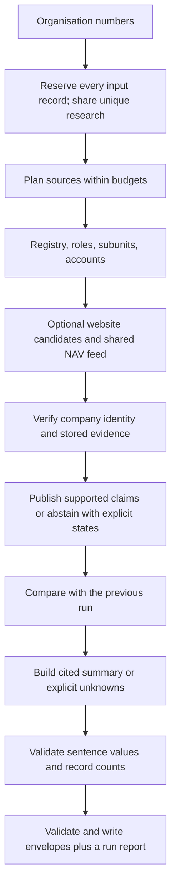

# The agent loop

Signalpost is a tool-using company-research agent. Source planning, identity verification, publication and template summaries use deterministic rules. Optional synthesis providers are constrained to approved claim placeholders; only a fake provider is tested in this release.

For each company:

1. Normalize the nine-digit organisation number and verify its mod-11 checksum. Reserve its output before requests. Invalid inputs retain failed envelopes without network access.
2. Plan identity lookup from the supplied bulk snapshot first, then the official live endpoint if absent. Read roles, subunits and exact-company annual accounts after identity succeeds.
3. When enabled, generate bounded website candidates from registry website/email and legal-name slugs. Fetch under robots, public-IP, timeout and request policies. Await the shared NAV index only at the hiring step; waiting releases registry worker slots.
4. Verify exact company/parent identifiers. Website corroboration can qualify only under the documented identity rules. Link claims to exact stored source bodies, locators and short verbatim spans.
5. Publish verified values, or an explicit availability state and null. Each source section and company is isolated. A global deadline preserves completed claims and marks incomplete work failed.
6. Compare supported values with the supplied previous envelopes. Separate company changes from observation failures, retaining non-expired prior supported facts when appropriate.
7. Build a template summary of activity, scale, leadership, changes and unknowns. Quote registered activity/purpose and accepted-site self-descriptions. Read website description tags and already-fetched about paragraphs without additional requests.
8. Check citations, evidence, identity thresholds, verbatim quotes and value tokens. Derived counts must equal distinct cited records of the declared type. Drop rejected sentences and explain empty sections. Synthesis never adds source claims, changes company events or turns a source envelope into a failure.

Template mode is the default. An injected provider can order approved placeholder frames; raw values or misbound citations trigger template fallback. Calls are bounded, cached and metered. No live provider adapter or API calls are enabled. A baseline summary includes the first-observation notice; reproducibility compares identical source claims, changes and prior-snapshot context.

The final writer preserves input order and input-record multiplicity, validates every envelope and the whole output, and publishes atomically. Research is shared for duplicates; `--deduplicate` explicitly emits unique identifiers. Exit zero means output was written; it does not mean every source succeeded.

See [identity rules](IDENTITY_RESOLUTION.md), [schema](DATA_SCHEMA.md), [refresh semantics](REFRESH.md) and [evaluation](EVAL.md).

## Bounded recall and public activity

Guessed email/slug domains receive a cached three-second DNS pre-check, with at most eight candidate lookups per company. NXDOMAIN spends no HTTP request; resolver failures leave the company check incomplete. Website candidates retain registry-site, email-domain, then slug order and stop after exact organisation-number proof. Connection-time public-IP checks remain mandatory.

NAV headers are ranked by distinctive-token overlap, with rare tokens weighted more heavily across the current feed. Legal suffixes and Norwegian/ASCII spelling variants affect discovery only. Details are fetched in rank order, including retries, within a configurable cap defaulting to min(candidate ads, max(300, 2 × unique companies)). Unchecked affected candidates remain failed; only exact company/listed-subunit employer numbers authorize publication.

With `--public-activity`, an accepted current website can supply dated news links from a same-domain head-linked RSS/Atom feed, a robots-declared sitemap, or `/sitemap.xml`. Discovery follows at most one sitemap-index level and permits at most one request beyond the website cap while preserving the overall company request ceiling. Author, category/tag and bare news-listing paths are excluded. Recent evidence-backed registry dates use no new requests. Site presentation and synthesis retain explicit source states and cite the original evidence. The weaker registry-declared website path is default-off after group-identity ambiguities in the audit.

## Optimizations and recall expansions (v1.1 - v4)

### Part A: NAV Performance and Registry Decoupling
- **Subunit pre-caching**: Subunit employer orgnr-to-parent mappings are extracted during initial bulk loading before registry API calls begin, preventing registry latency from blocking NAV candidate matching.
- **Producer/consumer worker queue**: Subunit scopes are pushed to an async queue as each company resolves, streaming candidate ads to detail workers immediately.
- **Detail concurrency tuning**: NAV detail concurrency supports up to 12 workers (`--nav-concurrency 8` default), bringing NAV total completion time down from 196.1s to 57.77s.

### Part B: Brave Search Integration & Strict Scoring
- **External web discovery**: Integrated Brave Search API (`api.search.brave.com`) queries with `site:.no` restriction, query rate-limiting, and cost tracking.
- **Mock fallback**: When live search keys are absent, deterministic mock search generates up to 15 domain variants per company.
- **Identity scoring**: Candidate domains require identity corroboration ($\ge 60$ points threshold based on legal name tokens, brand matches, and registry context) before attempting HTTP verification.

### Part C: Recall Expansion and UX Polish
- **Subunit ad coverage**: NAV advertisements matching subunit employer numbers are linked to parent legal entities with `matched_via = 'subunit <orgnr>'` claims, expanding hiring recall without false positives.
- **Sitemap & RSS probing**: Unverified website candidates are probed for `/sitemap.xml` and standard RSS feed paths (`/feed.xml`, `/rss.xml`) to extract valid company domains.
- **Interactive offline UI**: The static site generated in `--site-dir` includes live multi-field client-side search (<2 ms latency), sorting (by claims, A-Z, score, revenue, employees) with sessionStorage persistence, mobile-responsive layout (375px/768px/1024px), and persistent dark mode toggle.
