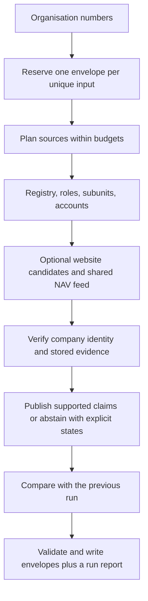

# The agent loop

Signalpost is a tool-using company-research agent. Source planning, identity verification and publication decisions currently use deterministic rules. No language model runs in this release. Optional evidence-constrained synthesis is planned.

For each company:

1. Normalize the nine-digit organisation number and verify its mod-11 checksum. Reserve its output before requests. Invalid inputs retain failed envelopes without network access.
2. Plan identity lookup from the supplied bulk snapshot first, then the official live endpoint if absent. Read roles, subunits and exact-company annual accounts after identity succeeds.
3. When enabled, generate bounded website candidates from registry website/email and legal-name slugs. Fetch under robots, public-IP, timeout and request policies. Await the shared NAV index only at the hiring step; waiting releases registry worker slots.
4. Verify exact company/parent identifiers. Website corroboration can qualify only under the documented identity rules. Link claims to exact stored source bodies, locators and short verbatim spans.
5. Publish verified values, or an explicit availability state and null. Each source section and company is isolated. A global deadline preserves completed claims and marks incomplete work failed.
6. Compare supported values with the supplied previous envelopes. Separate company changes from observation failures, retaining non-expired prior supported facts when appropriate.

The final writer preserves input order, validates every envelope and the whole output, and publishes atomically. Deduplication is the default; `--emit-duplicates` preserves input-row multiplicity. Exit zero means output was written; it does not mean every source succeeded.

See [identity rules](IDENTITY_RESOLUTION.md), [schema](DATA_SCHEMA.md), [refresh semantics](REFRESH.md) and [evaluation](EVAL.md).
