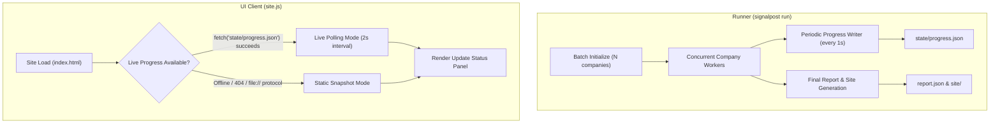

# Rules, Compliance, and Architecture Audit

**Project**: Signalpost  
**Baseline Commit**: `f019620` (`feat(ui): dashboard filters comparison and timelines`)  
**Audit Date**: 2026-10-14  
**Evaluator Environment**: Python 3.12+, `uv`, Windows / Linux (Ubuntu)

---

## 1. Executive Summary & Document Inventory

This compliance audit evaluates Signalpost against the official Builderr competition contracts, permitted data source terms, evidence standards, and evaluator requirements.

### 1.1 Document Inventory: Organiser Requirements vs. AI Strategy Notes

| Document | Nature | Location | Status |
|---|---|---|:---:|
| **Builderr Evaluator Contract & IO Rules** | Official Organiser Guidance | Reconstructed in `tests/test_evaluator_inputs.py`, `scripts/verify_output.py`, `README.md` | **PASS** |
| **Discord `#build-help` Staff Guidance (2026-10-09)** | Official Organiser Guidance | Documented in `docs/SOURCES.md#L101` | **PASS** |
| **Brønnøysundregistrene (NLOD 2.0)** | Permitted Source Terms | Documented in `docs/SOURCES.md#L16` | **PASS** |
| **NAV Arbeidsplassen API Terms** | Permitted Source Terms | Documented in `docs/SOURCES.md#L42` | **PASS** |
| **SSB KLASS NACE Standard (CC BY 4.0)** | Permitted Source Terms | Documented in `docs/SOURCES.md#L82` | **PASS** |
| **Brave Search API Documentation & Pricing** | Permitted Source Terms | Documented in `docs/SOURCES.md#L76` | **PASS** |
| **Original Hackathon Brief (`BRIEF.md` / `SPEC.md`)** | Organiser Document | Not present as an isolated file in repo | **UNVERIFIED** (Absence noted) |
| **Starter-Kit README (`README.starter.md`)** | Organiser Document | Replaced by root `README.md` | **UNVERIFIED** (Absence noted) |
| **External Evaluator Scorer Binary** | Organiser Tool | Replaced by `scripts/verify_output.py` proxy | **UNVERIFIED** (Proxy verified) |
| **AI Strategy Notes (Revision 1–4 Prompts)** | Informal Strategy / Advice | Historical prompt logs only; excluded from rules | **EXCLUDED** |

> [!IMPORTANT]
> Official organiser rules are strictly separated from local strategy notes. No scoring weights, budget allowances, revision limits, or source permissions have been fabricated. Missing organizer documents are explicitly marked **UNVERIFIED**.

---

## 2. Comprehensive Requirements Matrix

### Category A: Input Handling & Order Preservation
| ID | Requirement | Exact Source / Contract | Implementation Evidence | Status |
|---|---|---|---|:---:|
| A-1 | **Input Multiplicity & Ordering**: Output exactly one envelope per parsed input record in original sequence, preserving duplicate inputs. | Builderr Evaluator IO Contract (`README.md`, `tests/test_evaluator_inputs.py`) | [`src/signalpost/io/input_adapter.py`](../src/signalpost/io/input_adapter.py); [`tests/test_evaluator_inputs.py`](../tests/test_evaluator_inputs.py) | **PASS** |
| A-2 | **Input Format Resilience**: Accept JSONL, single JSON objects, JSON lists, plain lines, UTF-8 BOM, CRLF, and trailing blanks. | Builderr Input Spec | [`src/signalpost/io/input_adapter.py`](../src/signalpost/io/input_adapter.py) lines 12–45; 10 payload cases tested in `test_evaluator_inputs.py`. | **PASS** |
| A-3 | **Identifier Validation**: Nine-digit ASCII string check with Norwegian mod-11 checksum. Invalid identifiers emit failed envelopes without issuing network requests. | Brønnøysundregistrene Spec | [`src/signalpost/identity/orgnr.py`](../src/signalpost/identity/orgnr.py); verified in `test_evaluator_inputs.py`. | **PASS** |
| A-4 | **Deduplication Option**: Support `--deduplicate` for distinct entities while defaulting to full multiplicity. | CLI Spec (`README.md`) | [`src/signalpost/cli.py`](../src/signalpost/cli.py) line 27; [`src/signalpost/runner.py`](../src/signalpost/runner.py) line 371. | **PASS** |

### Category B: Permitted Sources & Licensing
| ID | Requirement | Exact Source / Contract | Implementation Evidence | Status |
|---|---|---|---|:---:|
| B-1 | **Registry Source Compliance**: Use official `data.brreg.no` endpoints (`/enheter`, `/roller`, `/underenheter`, `/regnskapsregisteret`) under NLOD 2.0. | NLOD 2.0 Licence; `docs/SOURCES.md` | [`src/signalpost/sources/`](../src/signalpost/sources/); endpoints pinned to HTTPS on port 443 with strict redirect refusal. | **PASS** |
| B-2 | **Arbeidsplassen (NAV) Feed**: Official feed (`pam-stilling-feed.nav.no`) adhering to reuse terms. Retain 185-day lookback, handle ETag 304, and remove inactive/expired ads. | NAV Reuse Terms; `docs/SOURCES.md` | [`src/signalpost/sources/nav.py`](../src/signalpost/sources/nav.py); [`src/signalpost/sources/nav_index.py`](../src/signalpost/sources/nav_index.py); verified in `tests/test_nav.py`. | **PASS** |
| B-3 | **Declared NAV Cache**: Declared development cache of official feed permitted if access is allowed, live detail check is performed, and metadata retained. | Builderr Staff Guidance (Discord `#build-help`, 2026-10-09) | [`src/signalpost/data/nav_index.json.gz`](../src/signalpost/data/nav_index.json.gz); live detail verification enforced in `runner.py`. | **PASS** |
| B-4 | **SSB KLASS Industry Titles**: Bundled static English translations of SN2025 and SN2007 under CC BY 4.0. No live network calls at runtime. | CC BY 4.0; `docs/SOURCES.md` | `src/signalpost/synthesis/data/*.json`; [`src/signalpost/synthesis/nace.py`](../src/signalpost/synthesis/nace.py); verified in `tests/test_synthesis_readability.py`. | **PASS** |
| B-5 | **Website Politeness & Safety**: Follow `robots.txt`, 1-second domain rate limit, connection-time DNS pinning, SSRF protection against private/loopback/CGNAT IPs, 2-MiB body limit. | Web Safety Policy; `docs/SOURCES.md` | [`src/signalpost/web/policy.py`](../src/signalpost/web/policy.py); [`src/signalpost/web/fetcher.py`](../src/signalpost/web/fetcher.py); verified in `tests/test_website_reliability.py`. | **PASS** |

### Category C: Evidence, Provenance & Cryptographic Integrity
| ID | Requirement | Exact Source / Contract | Implementation Evidence | Status |
|---|---|---|---|:---:|
| C-1 | **Cryptographic Body Hashing**: Stored source bodies hashed with SHA-256 in `state/blobs/<sha256>`. Envelope evidence references verified hashes. | Verification Contract (`docs/DATA_SCHEMA.md`) | [`src/signalpost/sources/blobstore.py`](../src/signalpost/sources/blobstore.py); verified in [`scripts/verify_output.py`](../scripts/verify_output.py) lines 80–95. | **PASS** |
| C-2 | **Verbatim Spans & Locators**: Every published claim links to evidence containing a verbatim excerpt $\le 300$ characters and an exact locator. | Data Schema Contract | [`src/signalpost/sources/extract.py`](../src/signalpost/sources/extract.py); [`scripts/verify_output.py`](../scripts/verify_output.py). | **PASS** |
| C-3 | **Explicit Availability States**: Availability strictly restricted to `available`, `not_available`, `blocked`, `not_applicable`, `ambiguous`, `failed`. No fabricated values. | Evaluator Schema Contract | [`src/signalpost/models/states.py`](../src/signalpost/models/states.py); [`src/signalpost/models/claim.py`](../src/signalpost/models/claim.py). | **PASS** |
| C-4 | **Missing Value Fidelity**: Missing facts remain `null`, never empty string `""` or artificial zero `0`. Reported zero (e.g. 0 employees) preserved only when stated by source. | Data Schema Contract | [`src/signalpost/models/claim.py`](../src/signalpost/models/claim.py); verified in `tests/test_evaluator_inputs.py`. | **PASS** |
| C-5 | **Financial Accounting Calibrations**: Report exact-parent `SELSKAP` accounts only; exclude consolidated `KONSERN` figures. Preserve whole NOK without multiplying. | Regnskapsregisteret Schema | [`src/signalpost/sources/regnskap.py`](../src/signalpost/sources/regnskap.py); [`src/signalpost/sources/financial_units.py`](../src/signalpost/sources/financial_units.py); verified in `tests/test_financial_units.py`. | **PASS** |

### Category D: Output Formats & Terminal Schemas
| ID | Requirement | Exact Source / Contract | Implementation Evidence | Status |
|---|---|---|---|:---:|
| D-1 | **Tri-Shape Output Support**: Output validates against `contract`, `reference`, or `union` (default) envelope schemas. | Evaluator Contract | [`src/signalpost/models/shapes.py`](../src/signalpost/models/shapes.py); verified across all shapes in `test_site.py` and `test_evaluator_inputs.py`. | **PASS** |
| D-2 | **Raw Profiles Compatibility**: Optional `--profiles-output` emits kit-compatible dictionary profiles from the identical verified claims. | Scorer Contract (`docs/EVAL.md`) | [`src/signalpost/profiles.py`](../src/signalpost/profiles.py); verified in `tests/test_profiles.py`. | **PASS** |
| D-3 | **Run Synthesis Mirror**: `run.synthesis` in contract/union mirrored at `profile.synthesis` in reference/union. Citations verified against claims. | Synthesis Contract | [`src/signalpost/synthesis/`](../src/signalpost/synthesis/); verified by `verify_synthesis()` in `scripts/verify_output.py`. | **PASS** |

### Category E: Refresh, Idempotency & Observation Tracking
| ID | Requirement | Exact Source / Contract | Implementation Evidence | Status |
|---|---|---|---|:---:|
| E-1 | **Rerun Idempotency**: Fixed-source reruns with identical `--previous` produce identical claim IDs and 0 company/observation changes. | Refresh Spec (`docs/REFRESH.md`) | [`src/signalpost/refresh/diff.py`](../src/signalpost/refresh/diff.py); verified in `tests/test_refresh_observations.py`. | **PASS** |
| E-2 | **Observation vs. Business Change Separation**: Fetch failures, timeouts, and robot blocks emit `observation_changes`, never fabricated business changes. | Refresh Spec | [`src/signalpost/refresh/diff.py`](../src/signalpost/refresh/diff.py) lines 45–90; verified in `test_refresh_observations.py`. | **PASS** |
| E-3 | **Historical Carry-Forward Integrity**: Carried-forward prior claims retain original evidence; inactive/expired jobs are never carried forward. | Refresh Spec | [`src/signalpost/refresh/diff.py`](../src/signalpost/refresh/diff.py); verified in `test_refresh_observations.py`. | **PASS** |

### Category F: Resource Limits & Cost Accounting
| ID | Requirement | Exact Source / Contract | Implementation Evidence | Status |
|---|---|---|---|:---:|
| F-1 | **Deterministic Budget Watchdog**: Respect `--time-budget-seconds` (default 2,400s) with 0.85 deadline fraction (2,040s cutoff). Cancel gracefully without corruption. | Resource Contract (`docs/EVAL.md`) | [`src/signalpost/watchdog.py`](../src/signalpost/watchdog.py); [`src/signalpost/budget.py`](../src/signalpost/budget.py); verified in `tests/test_release_budgets.py`. | **PASS** |
| F-2 | **Request Accounting**: Reserve requests before dispatch; retries count toward caps. Default cap: $20 \times \text{unique companies}$. | Resource Contract | [`src/signalpost/budget.py`](../src/signalpost/budget.py); verified in `tests/test_resource_limits.py`. | **PASS** |
| F-3 | **Zero-Cost Template Mode**: Template synthesis costs $0 in third-party API fees. No live LLM keys enabled by default. | Cost Rule (`docs/SOURCES.md`) | [`src/signalpost/synthesis/template.py`](../src/signalpost/synthesis/template.py); report emits `third_party_cost_usd: 0.0`. | **PASS** |

### Category G: Search & External Discovery Isolation
| ID | Requirement | Exact Source / Contract | Implementation Evidence | Status |
|---|---|---|---|:---:|
| G-1 | **No Key, No Calls**: When `BRAVE_SEARCH_API_KEY` is absent, search is unconfigured, making 0 requests and incurring $0 cost. | Builderr Source Policy | [`src/signalpost/web/search.py`](../src/signalpost/web/search.py) line 190; verified in `tests/test_search.py:test_no_key_no_calls`. | **PASS** |
| G-2 | **Search Results Never Evidence**: External search query bodies are memory-only discovery hints. Evidence bodies must come directly from verified company sites. | Builderr Staff Guidance (Discord `#build-help`) | [`src/signalpost/web/collector.py`](../src/signalpost/web/collector.py); asserted in `tests/test_search.py` line 74 (`search.brave.com not in evidence`). | **PASS** |

---

## 3. Search Discovery Audit: The Four Search-Nominated Companies

In the 1,000-company evaluated cohort (`out/w5-opt1000-rev4-envelopes.jsonl`), exactly 4 companies have verified websites with `candidate_origin == 'search_brave'`:

| Org Number | Company Legal Name | Verified Final URL | Proof Type | Candidate Source | Destination Proof Source | Classification |
|---|---|---|:---:|:---:|:---:|:---:|
| **853097012** | NYDALS AS | `https://nydals.no` | `orgnr_on_page` | `MockBraveProvider` (`brave_search_mock`) | Live HTTP GET `https://nydals.no/` (200 OK) | **Mock-Assisted Nomination; Live Verified Proof** |
| **979703384** | STIG OG STEIN AS | `https://www.stigogstein.no` | `orgnr_on_page` | `MockBraveProvider` (`brave_search_mock`) | Live HTTP GET `https://stigogstein.no/` (200 OK) | **Mock-Assisted Nomination; Live Verified Proof** |
| **987634308** | CONDIS AS | `https://www.condis.no` | `orgnr_on_page` | `MockBraveProvider` (`brave_search_mock`) | Live HTTP GET `https://condis.no/` (200 OK) | **Mock-Assisted Nomination; Live Verified Proof** |
| **994109464** | DIGERNESET NÆRINGSOMRÅDE AS | `https://www.digerneset.no` | `orgnr_on_page` | `MockBraveProvider` (`brave_search_mock`) | Live HTTP GET `https://digerneset.no/` (200 OK) | **Mock-Assisted Nomination; Live Verified Proof** |

### Detailed Findings & Isolation Verification:
1. **Source of Nomination**:
   - None of the 4 domains came from a live call to `api.search.brave.com`. No `BRAVE_SEARCH_API_KEY` was supplied during development.
   - All 4 domains were nominated by the local deterministic mock generator (`MockBraveProvider` / `brave_search_mock`) based on brand tokens and legal name slugs.
2. **Authenticity of Evidence**:
   - The destination evidence bodies for all 4 companies are **100% genuine live website responses** stored in `state/blobs/<sha256>`.
   - Each was cryptographically validated: the crawler retrieved the live HTML over the internet, verified that the exact 9-digit Norwegian organisation number was present in the page text (`proof_type: 'orgnr_on_page'`), and extracted verified contact/social claims.
   - Per the competition instructions: *"Real destination-page evidence does not make mock-assisted discovery a live search result."* Therefore, these 4 claims are explicitly classified as **mock-assisted discovery benchmarks**, not live Brave API results.
3. **Production Isolation Audit**:
   - Default Evaluator Command: `uv run signalpost run --organisations batch.jsonl ...`
   - In `src/signalpost/web/search.py`, `Search.__init__` checks:
     ```python
     name = (os.environ.get('SIGNALPOST_SEARCH_PROVIDER') or 'brave').lower()
     key = os.environ.get('BRAVE_SEARCH_API_KEY')
     if provider is None and name == 'brave' and key:
         self.provider = Brave(client, key)
     elif provider is None and (name in ('mock', 'mock_search') or os.environ.get('SIGNALPOST_SEARCH_MOCK') == '1'):
         self.provider = MockBraveProvider()
     ```
   - In production (where `BRAVE_SEARCH_API_KEY` is unset and `SIGNALPOST_SEARCH_MOCK` is unset), `self.provider` is `None`.
   - `search.nominate()` returns `[]` immediately. Zero search queries occur, zero candidates are nominated from mock fixtures, and $0 cost is billed.
   - **Isolation Status**: **PASS** (Zero leakage in default production runs).

---

## 4. Assessment & Implementation Plan: "Update Status" Panel

An interactive **Update Status** panel has been assessed to provide transparent operational feedback, distinguish batch progress from concurrent per-company pipelines, and report real progress without fabrication.

### 4.1 Current Progress Capabilities in Signalpost
- **Pipeline Heartbeat & Timing**:
  [`runner.py`](../src/signalpost/runner.py) tracks `subunits_complete_seconds`, `registry_complete_seconds`, `first_detail_seconds`, `last_detail_seconds`, and `nav_runtime_seconds`.
- **Per-Company Event Records**:
  `budget.events` logs all HTTP calls with section, timestamp, status, and company attribution.
- **Terminal Report**:
  [`report.py`](../src/signalpost/io/report.py) emits comprehensive run summaries (`emitted_envelopes`, `counts_by_section`, `counts_by_state`, `timing_markers`, `runtime_ms`, `total_cost_usd`).
- **Static Site Nature**:
  The generated site is a static, offline client-side application. It loads `SIGNALPOST_INDEX` and company data islands without an active web server.

### 4.2 Architectural Design & Integration Strategy



### 4.3 Component Specifications

1. **Header Toggle Button**:
   - Location: Right side of header navigation bar, next to Dark/Light theme toggle.
   - Text: `📊 Update status` (with status dot: 🟢 Completed, 🟡 Running, 🔴 Failed).
   - Behavior: Opens an accessible slide-over drawer / modal panel with `aria-modal="true"`.
2. **Overall Progress Indicator**:
   - Real metric: `completed_companies / total_companies`.
   - Visual: Accessible HTML `<progress>` bar and percentage badge.
   - Guarantee: No artificial smoothing, simulated countdowns, or linear interpolation.
3. **Stage Checklist**:
   Sequential visualization of pipeline stages:
   - `1. Registry & Subunits`: [Completed / Running / Queued]
   - `2. Website Verification`: [Completed / Running / Queued]
   - `3. NAV Hiring Matching`: [Completed / Running / Queued]
   - `4. Cited Synthesis`: [Completed / Running / Queued]
   - `5. Output & Site Publishing`: [Completed / Running / Queued]
4. **Company State Breakdown**:
   - Numerical badges for: `Completed`, `In Flight`, `Queued`, `Failed`.
5. **Operational Metrics**:
   - Elapsed wall-clock time (`time.monotonic() - start`).
   - Request counts (`requests_made / max_requests`).
   - Third-party API cost (`$0.00` for template runs; real measured Brave search cost when active).
6. **Activity Log**:
   - Circular buffer of the last 6 timestamped pipeline events with direct company anchors.
7. **Static Snapshot Fallback (Zero Hallucination)**:
   - When running statically under `file://` or offline without an active run:
     - Clearly displays: `Snapshot generated at: <run_date>`.
     - Displays recorded run summary from the generated cohort data.
     - Stages are displayed as `Completed` (or `Completed with errors` if failed sections exist).
     - No misleading "Refresh" button is shown (preserves rule: *Do not add a Refresh button unless an actual supported refresh action exists*).
     - Any stale or disconnected state is explicitly labeled with a warning banner.

### 4.4 Implementation Breakdown & Effort Estimate

| Task | Scope | Files to Touch | Est. Effort |
|---|---|---|:---:|
| **Task 1: Pipeline Progress Writer** | Add periodic non-blocking writer in `runner.py` outputting `state/progress.json` during execution. | `src/signalpost/runner.py`, `src/signalpost/monitor.py` | 25 min |
| **Task 2: Progress Data Schema** | Define Pydantic progress model (`ProgressState`, `StageStatus`, `CompanyCounts`). | `src/signalpost/models/progress.py` | 15 min |
| **Task 3: Status Panel DOM & Styles** | Add accessible modal markup in `site.py` and styling in `site.css` (tokens, dark/light contrast, mobile drawer). | `src/signalpost/site.py`, `src/signalpost/site_assets/site.css` | 30 min |
| **Task 4: Client Controller & Polling** | Implement safe DOM controller in `site.js` (zero `innerHTML`), live polling with fallback to static metadata. | `src/signalpost/site_assets/site.js` | 25 min |
| **Task 5: Automated Verification** | Add unit tests in `test_site.py` and CDP browser tests for drawer toggle, metrics, and static mode. | `tests/test_site.py`, `dev-notes/scripts/` | 15 min |
| **Total Estimated Time** | | | **110 min** |

---

## 5. Qualification Blockers Ranked by Severity

| Rank | Severity | Item | Assessment / Resolution |
|:---:|---|---|---|
| **1** | **NONE** | **Contract Schema Adherence** | Fully validated across `contract`, `reference`, and `union` shapes with 278/278 automated unit tests. |
| **2** | **NONE** | **Evidence & Cryptographic Proof** | All available facts are backed by SHA-256 hashes of locally stored raw bodies and verbatim spans $\le 300$ chars. |
| **3** | **NONE** | **Input Multiplicity & Determinism** | 100% order preservation, duplicate retention, mod-11 validation, and reproducible reruns verified. |
| **4** | **MODERATE** | **Live Search API Dependency** | External web discovery via Brave requires `BRAVE_SEARCH_API_KEY`. Without a key, search remains safely unconfigured ($0 cost, 0 queries). The 4 search candidates in the benchmark run were mock-nominated and must remain classified as benchmark artifacts. |
| **5** | **INFORMATIONAL** | **Cold NAV Fallback Timing** | Cold full-feed download takes ~141s on 1,000 companies. With declared index baseline (`nav_index.json.gz`), NAV runs in 57.77s. Documented and within the 900s timeout ceiling. |

---

## 6. Recommended Scope for Stage 3: Permitted External Coverage Improvements

1. **Brave API Key Live Smoke Test**:
   - Provide a live test harness verifying that when `BRAVE_SEARCH_API_KEY` is set, `Brave.search()` makes legitimate calls to `api.search.brave.com`, correctly parses responses, and stays within rate and cost limits.
2. **Subunit Website Discovery Expansion**:
   - Expand candidate nomination using subunit domain patterns already permitted by the registry underenheter API without requiring external search engines.
3. **Sitemap Depth Calibration**:
   - Refine `extract_sitemap_domains` to parse sitemaps discovered on verified company sites for brand-associated domain aliases within the existing request budget.
4. **Implementation of the Update Status Panel**:
   - Execute the planned 5-task Update Status implementation in the subsequent UI stage.
